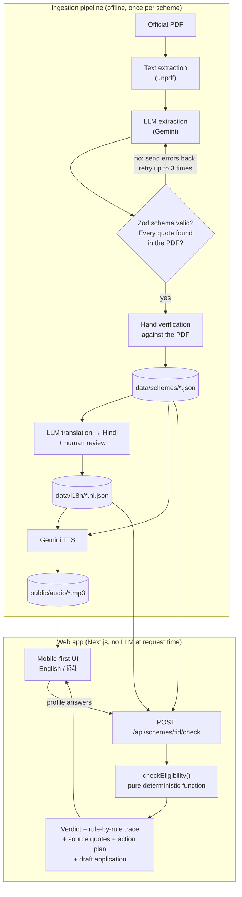

# Civic Pulse: Scheme Explainer

**Team Codesh** · Civic Pulse track (Digital Governance & Public Information) · Problem: *Multilingual Policy, Rights & Scheme Explainer*

**Live demo:** _add Vercel URL here_ · **Demo video:** _add link here_

Government schemes are written in dense legal English. The people they are meant for (farmers, artisans, students, daily-wage workers) often can't read them, don't know if they qualify, and don't know what to do next.

Civic Pulse turns official scheme documents into:

1. **A plain-language explainer** in English or Hindi, with audio you can listen to.
2. **An eligibility check** based on a few simple questions. The verdict shows every rule, your answer, and **the exact line from the official document** each rule comes from.
3. **An action plan**: documents to keep ready, application steps, the official portal, and a draft application filled in from your answers.

---

## Why you can trust the answer

Most "AI explainers" ask a language model whether you're eligible, and it may guess. We don't.

| | How it works |
|---|---|
| **AI reads the document once** | When a scheme is added, an LLM extracts it into structured JSON (benefits, eligibility rules, exclusions, documents, steps). |
| **Every claim carries a citation** | Each benefit, rule and exclusion has a `sourceClause`, an exact quote from the source PDF. The extractor rejects any quote that doesn't appear word for word in the document and asks the model to fix it. |
| **Humans verify before use** | Every scheme JSON is checked line by line against its PDF before it goes live. Only verified schemes are registered in the app. |
| **Code decides eligibility, not AI** | At request time, a pure deterministic function compares your answers with the rules. Same answers, same verdict, every time. |
| **"Not sure" is allowed** | Missing answers give **"Maybe eligible"** with a "find out first" list, never a guess. |
| **Hindi doesn't change the rules** | Translations replace only the display text. Rules and source quotes stay identical, and tests check that both languages give the same verdict. |

## Schemes included

| Scheme | Who it's for | Source document |
|---|---|---|
| PM Vishwakarma | Artisans and craftspeople in 18 traditional trades | [MoMSME guidelines](https://pmvishwakarma.gov.in/FileHandling/ViewFile/MiscFiles%5CPM%20Vishwakarma-Guidelines.pdf) |
| PM-KISAN | Land-owning farmer families | [Revised operational guidelines](https://pmkisan.gov.in/Documents/RevisedPM-KISANOperationalGuidelines(English).pdf) |
| Atal Pension Yojana | Informal-sector workers aged 18–40 | [PFRDA subscriber brochure](https://www.pfrda.org.in/documents/33652/307349/APY%20Subscriber%20Information%20Brochure%20English) |
| Sukanya Samriddhi Yojana | Parents of a girl under 10 | [Gazette notification G.S.R. 914(E)](https://www.nsiindia.gov.in/writereaddata/SchemeRules/SukanyaSamriddhiAccountSchemeRule.pdf) |
| Central Sector Scholarship (PM-USP CSSS) | College students from low-income families | [Ministry of Education guidelines](https://scholarships.gov.in/public/schemeGuidelines/Guidelines_DOHE_CSSS.pdf) |

All five are available in **English and Hindi**, with narration in both.

## Architecture



## Tech stack

- **Next.js 16** (App Router) + **React 19**, TypeScript in strict mode
- **Zod** for schema validation of every extracted scheme and every API request
- **unpdf** for PDF text extraction
- **Gemini** (through an OpenAI-compatible endpoint) for extraction and translation; **Gemini TTS** for narration. The extractor also supports the Anthropic API.
- **Vitest** for tests

## Run it locally

Requires Node.js 20.12 or newer.

```bash
npm install
npm run dev
```

Open http://localhost:3000 and switch language with **English / हिंदी** in the top-right corner.

The web app needs **no API keys**. It reads only the verified JSON and audio files in this repo.

```bash
npm test          # 38 tests: eligibility logic, extraction retries, quote checks, translations, all 5 schemes
npm run typecheck
npm run build
```

## Adding a scheme (the ingestion pipeline)

The pipeline scripts need an LLM key. Copy `.env.example` to `.env` and fill it in:

```bash
EXTRACT_PROVIDER=openai        # "openai" (any OpenAI-compatible API, e.g. Gemini) or "anthropic"
EXTRACT_MODEL=gemini-3.8-flash
OPENAI_API_KEY=<your key>
OPENAI_BASE_URL=https://generativelanguage.googleapis.com/v1beta/openai/
```

Then:

```bash
# 1. Extract: PDF → validated JSON in data/schemes/, raw text in data/text/
npm run extract -- data/pdfs/my-scheme.pdf --source-url "<official URL>" --id my-scheme

# 2. Re-check every quote against the source text (also after hand edits)
npm run verify -- my-scheme

# 3. Hand-check the JSON against the PDF, then register it in src/lib/schemes.ts

# 4. Translate (output goes to data/i18n/), review, then register it in src/lib/translations.ts
npm run translate -- my-scheme hi

# 5. Generate narration (needs ffmpeg) → public/audio/
npm run tts -- my-scheme hi
npm run tts -- my-scheme en
```

**Adding a new language** works the same way: `npm run translate -- <scheme> <code>` supports Hindi, Bengali, Tamil, Telugu, Marathi, Gujarati, Kannada, Malayalam, Punjabi, Odia, Urdu and Assamese. You'd also add that language's interface text to `src/lib/i18n.ts`.

## API

| Method | Route | Returns |
|---|---|---|
| `GET` | `/api/schemes?lang=hi` | All verified schemes (summary, source URL, audio URL) |
| `GET` | `/api/schemes/:id?lang=hi` | Full scheme with citations, and the generated questions |
| `POST` | `/api/schemes/:id/check` | Body `{ "profile": {...}, "lang": "hi" }` → verdict (`true` / `false` / `"unknown"`), rule-by-rule trace with source quotes, action plan, draft application |

Example:

```bash
curl -X POST http://localhost:3000/api/schemes/pm-vishwakarma/check \
  -H 'content-type: application/json' \
  -d '{"profile":{"age":42,"occupation":"tailor","other":{"isSelfEmployedInformal":true,"hasDisqualifyingLoanPast5Years":false,"familyMemberAlreadyRegistered":false,"familyInGovernmentService":false}}}'
```

## Project structure

```
data/
  pdfs/        source government documents
  text/        extracted text (used for quote verification)
  schemes/     verified scheme JSON (the single source of truth)
  i18n/        reviewed translations
public/audio/  narration, one file per scheme per language
src/
  types.ts             Zod schemas: Scheme, Rule, UserProfile
  eligibility.ts       checkEligibility(): the deterministic rules engine
  extract.ts           PDF → LLM → validated JSON, with retries and quote checks
  verify.ts            quote verification against source text
  translate.ts         LLM translation with structure checks
  tts.ts               Gemini TTS narration
  lib/                 questions, verdict + action plan, i18n, scheme registry
  app/                 Next.js pages and API routes
```

## Limitations

- **Not legal advice.** Every page links to the official document, and the final decision is always made by the government department.
- Some rules can't be checked from a form (for example "recognised institution" or land-record status). We ask these as yes/no questions and show the exact official wording, so the user knows what to confirm.
- Scheme rules change. Each JSON is tied to a specific dated source document, and old figures such as interest rates are labelled as such.
- Hindi translations were reviewed by us. A native-speaker review across more languages is the next step.

---

Built by **Team Codesh** for the Civic Pulse hackathon, November 2026.
